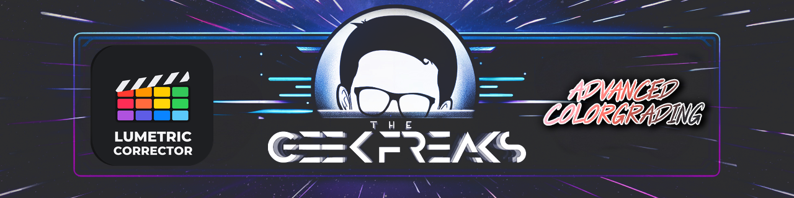
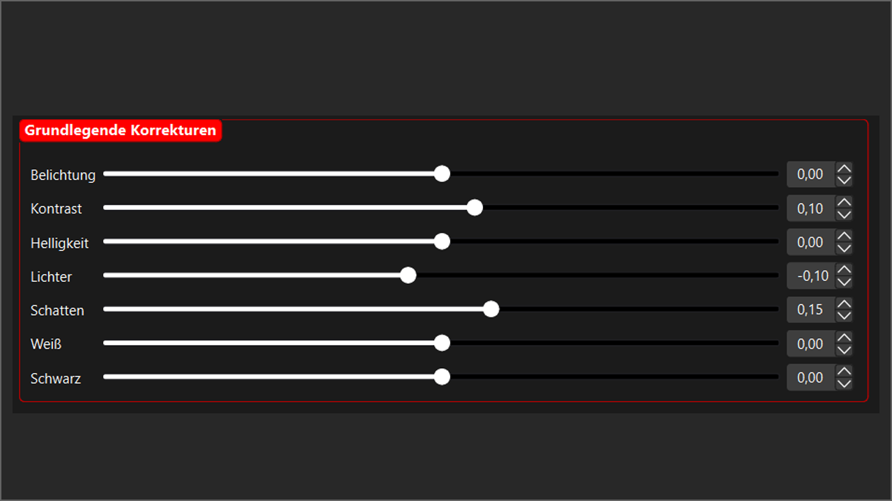
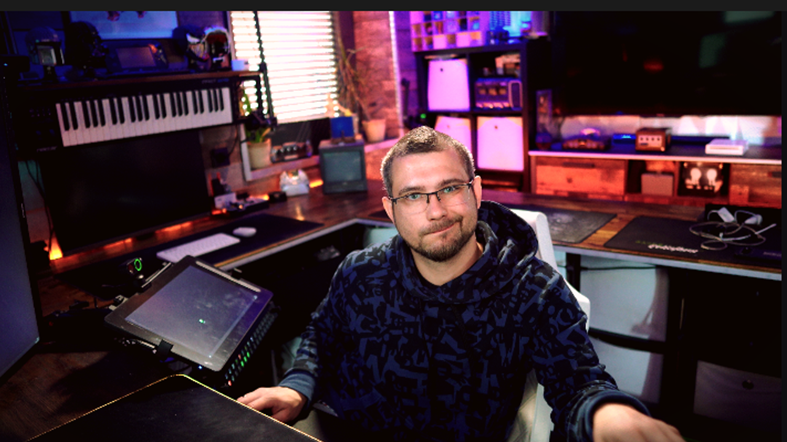
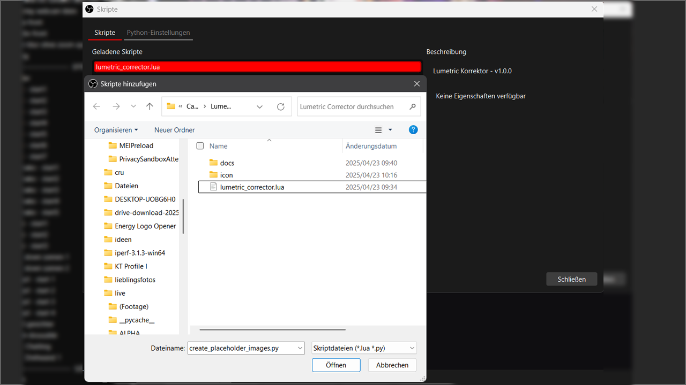
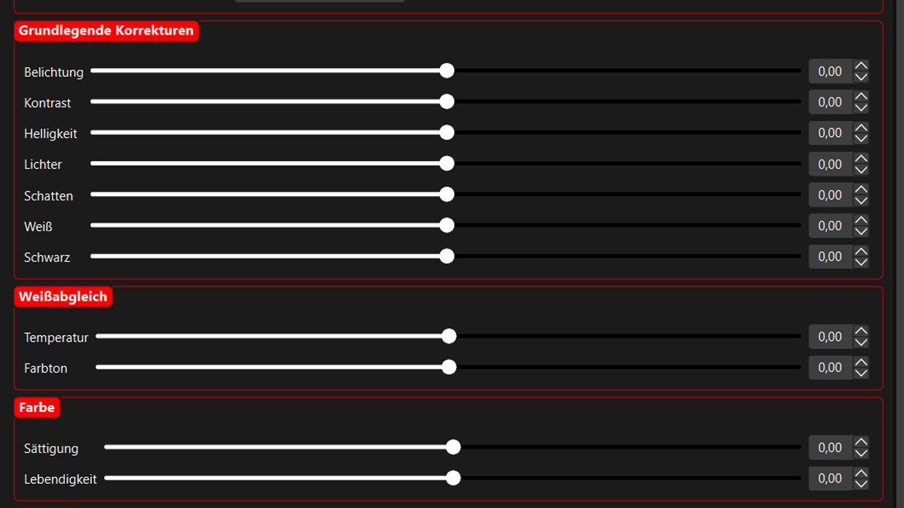
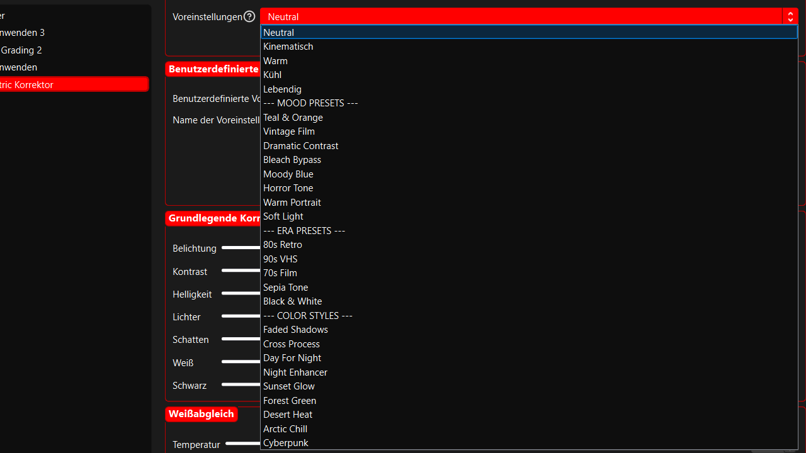
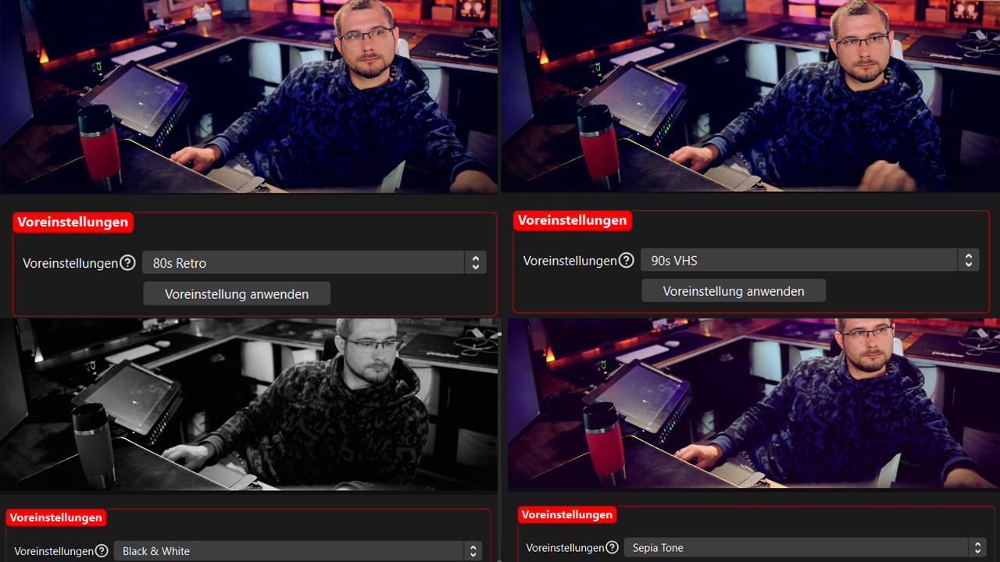
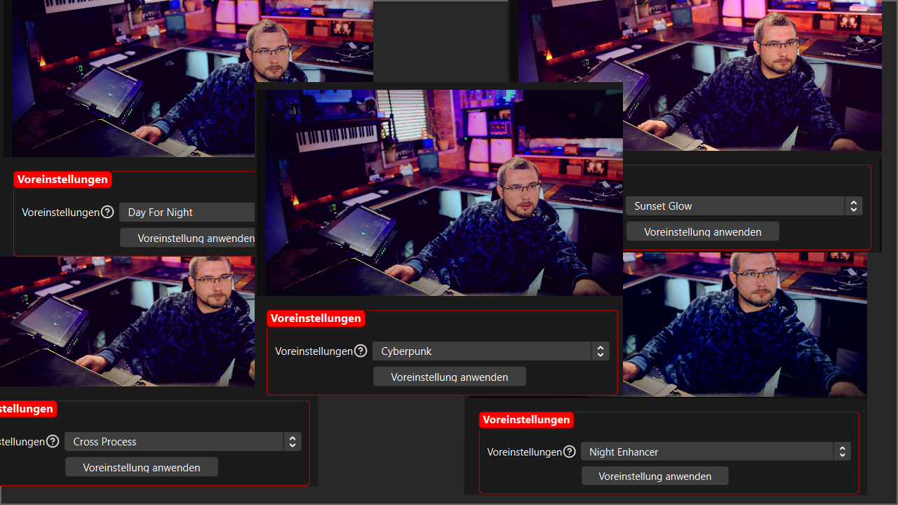

<div align="center">
  <h1>🎬 Lumetric Corrector for OBS Studio</h1>
  <p>A professional color correction and grading filter for OBS Studio — one Lua script, no dependencies.</p>
  <p>For streamers, content creators and videographers who want cinematic color without leaving OBS.</p>

  
  
  
  
  
  
  
  
  [](https://tgf.click/discord)
</div>

<div align="center">
  
</div>

## 📑 Table of Contents
- [✨ Key Features](#-key-features)
- [💻 Installation](#-installation)
- [🎮 Usage](#-usage)
- [🎨 Presets](#-presets)
- [🛠️ Controls](#️-controls)
- [🧊 3D LUTs](#-3d-luts)
- [💾 Looks & LUT Export](#-looks--lut-export)
- [🔧 Troubleshooting](#-troubleshooting)
- [🧑‍💻 Development](#-development)
- [📝 Changelog](#-changelog)
- [📄 License](#-license)

## ✨ Key Features

### 🖌️ Color Correction
- **Tone**: Exposure, Contrast, Brightness, Highlights, Shadows, Whites, Blacks — luminance-weighted so tone changes do not shift hues
- **Fade & Lift**: Highlight Fade, Shadow Fade and Black Lift for matte and bleach film looks
- **White Balance**: Temperature and Tint
- **Color**: Saturation and Vibrance

### 🎨 Color Grading
- **Color Wheels**: separate RGB offsets for Shadows, Midtones and Highlights (Lift / Gamma / Gain)
- **Split Toning**: independent color and strength for shadows and highlights
- **3D LUTs**: load `.cube` (any size) or `.png` LUTs with adjustable strength — works on Windows, macOS and Linux

<div align="center">
  
</div>

### ✨ Creative Effects
- **Bloom** (thresholded 9-tap glow), **Halation** (warm glow around highlights), **Sharpen** (unsharp mask)
- **Film Grain**: animated, luminance-weighted grain with size control
- **Vignette** with radius, feather and shape
- **Mask**: apply the whole grade only inside an ellipse or rectangle with soft edges

<div align="center">
  
</div>

### 🎛️ Workflow
- **47 presets** in five categories, applied instantly when selected
- **Looks**: save and load all color settings as JSON to share between scenes, profiles and machines
- **LUT export**: bake the current look into a `.cube` (33³) or an OBS-compatible 512×512 `.png` LUT
- **Bilingual UI** with tooltips in English and German (follows the OBS language)
- **Reset all** button, LUT status line, sensible defaults

### ⚙️ Under the hood
- Single GPU pass; uniforms are only uploaded when a setting changes
- One parameter table drives defaults, UI, update and shader binding — controls, presets and shader cannot drift apart
- Old scenes are migrated automatically (internal keys leaked by earlier versions are removed)

## 💻 Installation

1. Download `lumetric_corrector.lua` from the [latest release](https://github.com/The-Geek-Freaks/lumetric_corrector/releases/latest)
2. Put it somewhere permanent, e.g. your OBS scripts folder:
   - Windows: `%APPDATA%\obs-studio\scripts`
   - macOS: `~/Library/Application Support/obs-studio/scripts`
   - Linux: `~/.config/obs-studio/scripts`
3. In OBS Studio open **Tools → Scripts**, click **+** and select the file
4. Add **Lumetric Corrector** as a filter to any source or scene (**Filters → + → Lumetric Corrector**)

<div align="center">
  
</div>

Requirements: OBS Studio 30.0 or newer on Windows 10/11, macOS 11+ or Linux. No additional dependencies.

## 🎮 Usage

1. **Start with a preset** — pick one from the dropdown; it is applied immediately. Mask and LUT settings are never touched by presets.
2. **Fine-tune** — Tone first (exposure, contrast), then white balance, then color wheels / split toning for the look, then effects.
3. **Optional** — load a 3D LUT, or save the result as a look file / LUT for reuse.

Tips:
- Keep adjustments subtle; most sliders are designed so that ±0.2 is already a strong change.
- Bloom, halation, sharpen and grain are the only effects that cost noticeable GPU time. Leave them at 0 when not needed.
- Use the mask to grade only a face cam region or to vignette a specific area.

<div align="center">
  
</div>

## 🎨 Presets

| Category | Presets |
|----------|---------|
| **Basic** | Neutral, Warm, Cool, Bright, Dark, Contrast Boost, Contrast Reduce |
| **Style** | Cinematic, Filmic, Dramatic Contrast, Vibrant, Muted, Warm Contrast, Cool Contrast, Bleach Bypass, Faded Shadows, Cross Process, Crisp Clarity |
| **Mood** | Warm Highlights, Blue Shadows, Green Shadows, Sunset Glow, Moonlight, Vivid Warm, Moody Blue, Warm Portrait, Day For Night, Night Enhancer, Forest Green, Desert Heat, Arctic Chill, Horror Atmosphere |
| **Era** | Vintage Film, Retro Film, 70s Film, 80s Retro, 90s VHS, Analog VHS, Sepia Tone, Black & White, B&W High Contrast |
| **Creative** | Neo Noir, Cyberpunk, Teal & Orange, Dreamy Bloom, Pastel Dreams, Game Stream |

<div align="center">
  
  
  
</div>

## 🛠️ Controls

| Group | Control | Range | Notes |
|-------|---------|-------|-------|
| Tone | Exposure | −1 … 1 | stops; +1 doubles the light |
| Tone | Contrast, Brightness | −1 … 1 | contrast pivots at mid grey |
| Tone | Highlights, Shadows, Whites, Blacks | −1 … 1 | luminance-weighted tonal ranges |
| Fade & Lift | Highlight Fade, Shadow Fade, Black Lift | 0 … 1 | matte / bleach looks |
| White Balance | Temperature, Tint | −1 … 1 | + = warmer / magenta |
| Color | Saturation, Vibrance | −1 … 1 | saturation −1 = black & white |
| Color Wheels | Shadows / Midtones / Highlights R, G, B | −1 … 1 | additive per tonal range |
| Split Toning | Shadows / Highlights R, G, B + Strength | −1 … 1 / 0 … 1 | strength 0 = off |
| Creative Effects | Sharpen, Bloom, Halation, Film Grain | 0 … 1 | spatial effects |
| Creative Effects | Grain Size | 1 … 8 px | relative to 1080p |
| Vignette | Amount, Radius, Feather, Shape | 0 … 1 | shape 0 = circle, 1 = oval |
| Mask | Enable, Shape, Center X/Y, Width, Height, Feather | 0 … 1 | checkable group |
| 3D LUT | LUT File, LUT Strength | 0 … 1 | strength defaults to 1 |

## 🧊 3D LUTs

- **`.cube`** files of any size (2 … 256) are parsed by the script, converted to a 16-bit PNG atlas once and cached in the OBS `plugin_config/lumetric_corrector` folder. Loading the same file again is instant.
- **`.png`** files are loaded directly. Supported layouts: the OBS 512×512 grid (64³, 8 tiles per row — the format of OBS's own "Apply LUT" filter) and an N·N × N strip.
- The LUT is applied after the color grade and before vignette/grain/mask; **LUT Strength** blends between the graded image and the LUT result.
- The **LUT status** line in the LUT group tells you the loaded cube size or why a file was rejected.

## 💾 Looks & LUT Export

- **Save look (JSON)** writes every color setting (not mask or LUT path) to a small file; **Load look** applies such a file to the current filter.
- **Export current look as LUT** bakes the non-spatial part of the grade — tone, white balance, wheels, split toning, saturation, vibrance and a loaded `.cube` LUT — into a LUT:
  - `.cube`: 33×33×33, usable in Resolve, Premiere, OBS and most other tools
  - `.png`: 512×512 grid, usable directly in OBS's built-in "Apply LUT" filter
- Bloom, halation, sharpen, grain, vignette and mask depend on neighbouring pixels or position and therefore cannot be part of a LUT.

## 🔧 Troubleshooting

| Symptom | What to check |
|---------|---------------|
| Filter not listed | OBS 30+; script added under Tools → Scripts; check the **Script Log** for `[Lumetric]` lines |
| LUT has no effect | Read the **LUT status** line; LUT Strength above 0; for PNGs use the 512×512 grid layout |
| Image looks too strong | Click **Reset all settings**, then start with a preset |
| Higher GPU load | Set Bloom, Halation, Sharpen and Film Grain to 0 |
| Settings from an old version look different | 3.0 corrected several math errors (bloom, halation, tone weighting, tint sign); re-check affected presets |

Still stuck? Open an [issue](https://github.com/The-Geek-Freaks/lumetric_corrector/issues) with your OBS version, platform and the relevant Script Log lines, or ask on [Discord](https://tgf.click/discord).

## 🧑‍💻 Development

Everything lives in `lumetric_corrector.lua`. The `dev/` folder contains the tooling used to verify a release without starting OBS:

```bash
# End-to-end run of the script against an obslua mock (LuaJIT via lupa)
uv run --with lupa python dev/run_lua.py dev/tests/test_script.lua

# Module unit tests (PNG encoder, CUBE parser / atlas, colour pipeline port)
uv run --with lupa python dev/run_lua.py dev/tests/test_png_encoder.lua
uv run --with lupa python dev/run_lua.py dev/tests/test_cube_lut.lua
uv run --with lupa python dev/run_lua.py dev/tests/test_grade_pixel.lua

# Compile the embedded effect with the Windows HLSL compiler (fxc)
uv run python dev/effect_to_hlsl.py --from-lua lumetric_corrector.lua
```

`dev/shader_spec.effect` is the reference for the color pipeline; the Lua LUT exporter mirrors its non-spatial stages exactly (checked against an independent Python port).

## 📝 Changelog

See [CHANGELOG.md](./CHANGELOG.md) for all versions.

**3.0.0 highlights**: all tone controls in the UI, working 3D LUTs (`.cube` and `.png`) on every platform, 47 presets that actually apply, film grain is back, look files, PNG LUT export, bilingual tooltips, faithful LUT export, many math and stability fixes.

## 📄 License
This project is licensed under the GNU General Public License v3.0 — see the LICENSE file for details.

---

<div align="center">
  <p>Created with 💙 for the content creation community</p>
</div>
